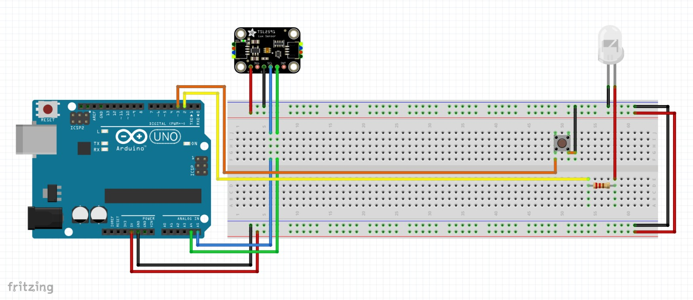

# Coleta de luminosidade com TSL2591 + botão + LED (Arduino UNO)

Um botão liga e desliga a coleta de dados do sensor de luz **TSL2591**, da Adafruit.
O LED fica aceso enquanto a coleta está ativa.

| Ação | Resultado |
|---|---|
| Energizar a placa | Nada acontece: LED apagado, sem coleta |
| 1º aperto do botão | O LED acende e a coleta começa |
| 2º aperto do botão | O LED apaga e a coleta para |
| Próximos apertos | Continua alternando |



## Material

- 1 Arduino UNO
- 1 sensor de luz Adafruit TSL2591
- 1 LED (de qualquer cor)
- 1 resistor de 220 Ω a 330 Ω (para o LED)
- 1 botão de pressão (push button) de 4 pernas
- 1 protoboard e fios jumper

O botão **não precisa de resistor**, porque o código liga o pull-up interno do Arduino (`INPUT_PULLUP`).

## Ligações

### Alimentação (trilhos da protoboard)
| De | Para | Fio no diagrama |
|---|---|---|
| Arduino **5V** | trilho **+** inferior da protoboard | vermelho |
| Arduino **GND** | trilho **−** inferior da protoboard | preto |
| trilho + inferior | trilho + superior (pela ponta direita) | vermelho |
| trilho − inferior | trilho − superior (pela ponta direita) | preto |

### Sensor TSL2591 (comunicação I2C)
| Pino do sensor | Ligado em | Fio |
|---|---|---|
| VIN | trilho + (5V) | vermelho |
| GND | trilho − (GND) | preto |
| SCL | Arduino **A5** | azul |
| SDA | Arduino **A4** | verde |

A placa da Adafruit aceita de 3 V a 5 V no VIN, então pode ligar no 5V do Arduino sem problema.

### LED
| De | Para | Fio |
|---|---|---|
| Arduino **pino 2** | uma ponta do resistor | amarelo |
| outra ponta do resistor | perna **longa (+, ânodo)** do LED | vermelho |
| perna **curta (−, cátodo)** do LED | trilho − (GND) | preto |

### Botão
| De | Para | Fio |
|---|---|---|
| Arduino **pino 3** | um lado do botão | laranja |
| outro lado do botão | trilho − (GND) | preto |

## Software

1. Instale a [Arduino IDE](https://www.arduino.cc/en/software).
2. Em **Ferramentas → Gerenciar Bibliotecas**, instale **Adafruit TSL2591 Library**. Aceite também a dependência **Adafruit Unified Sensor**.
3. Abra `controle_tsl2591/controle_tsl2591.ino`, escolha a placa **Arduino UNO** e a porta certa, e clique em **Carregar**.
4. Abra o **Monitor Serial** em **9600 baud**.

Durante a coleta, o código envia uma linha a cada 0,5 s, separada por `;`:

```
--- Coleta INICIADA ---
tempo_s;lux;luz_total;infravermelho;visivel
0.00;152.34;5210;1830;3380
0.50;151.98;5204;1828;3376
...
--- Coleta PARADA ---
```

Para levar os dados a uma planilha, copie as linhas do Monitor Serial e cole no Excel ou no Google Planilhas, usando `;` como separador. Também dá para usar o **Plotter Serial** para ver um gráfico.

## Ajustes rápidos (no início do código)

- `INTERVALO_LEITURA_MS`: o tempo entre leituras (padrão 500 ms).
- `TSL2591_GAIN_MED`: o ganho do sensor. Use `TSL2591_GAIN_LOW` sob luz muito forte (sol direto) e `TSL2591_GAIN_HIGH` em ambientes escuros.

## Problemas comuns

- **"ERRO: TSL2591 nao encontrado"**: confira VIN e GND. Confira também se o SDA está no A4 e o SCL no A5, sem estarem trocados.
- **O LED não acende**: o LED pode estar invertido (a perna longa vai para o lado do resistor/pino 2). Confira também se o resistor e o LED estão na mesma coluna da protoboard.
- **O botão parece estar sempre apertado, ou não faz nada**: gire o botão 90°. As pernas de um botão de 4 pernas são ligadas em pares por dentro. O mais seguro é colocá-lo **atravessando o canal central** da protoboard.
- **Os trilhos não conduzem até o fim**: em algumas protoboards grandes, os trilhos de alimentação são divididos ao meio. Se for o caso, coloque um jumper ligando as duas metades.
